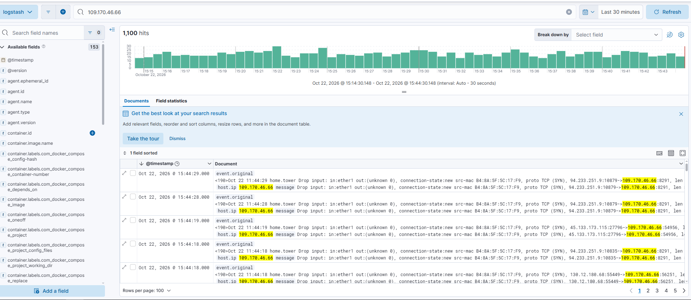
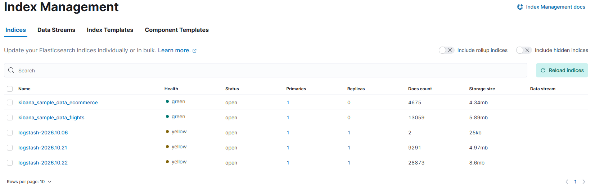
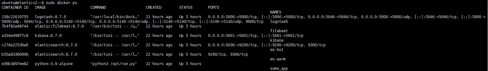

# ELK Stack — Мониторинг и Визуализация

В данном репозитории собраны примеры визуализации данных и мониторинга инфраструктуры с помощью стека **ELK (Elasticsearch, Logstash, Kibana)**.

---

## 📸 Скриншоты

### 1. Дашборд в Kibana
Общий вид панели управления с графиками и виджетами, демонстрирующий поток данных в реальном времени.

  

---

### 2. Управление индексами
Просмотр списка индексов в Elasticsearch, их размеров и состояния здоровья кластера.

  

---

### 3. Мониторинг Uptime
Отслеживание доступности сервисов и сетевых устройств (Uptime).

  

---

## 🛠 Используемые компоненты

* **Elasticsearch** — хранение и поиск данных.
* **Logstash** — сбор и обработка логов (TCP JSON, Syslog).
* **Kibana** — визуализация и построение дашбордов.
* **Filebeat** — доставка логов Docker-контейнеров.

---
*Проект создан в учебных целях.*
